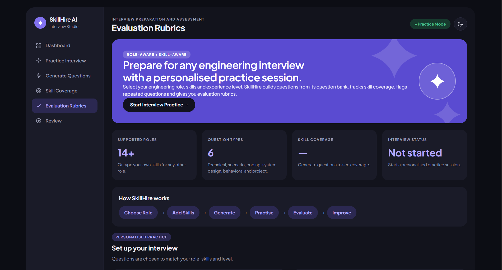

# SkillHire AI — Interview Preparation Platform

SkillHire AI is an interview preparation platform designed for college placement students. It helps students practise role-based interview questions, explore skill coverage, and evaluate their answers using rubrics.

## Website Preview



## Features

- Practice interviews for different job roles.
- Generate questions using a built-in question bank and templates.
- Select Basic, Intermediate, and Advanced difficulty levels.
- Review skill coverage and evaluation rubrics.
- Organize interview practice sessions.
- Use a Node.js, Express, and PostgreSQL backend for supported API operations.

## Tech Stack

**Frontend:** HTML, CSS, JavaScript

**Backend:** Node.js, Express.js

**Database:** PostgreSQL

## Project Structure

```text
SkillHire-AI/
├── SkillHire-AI-frontend/
│   ├── index.html
│   ├── style.css
│   ├── script.js
│   └── extras/
├── SkillHire-AI-backend/
│   ├── src/
│   ├── database/
│   ├── package.json
│   └── .env.example
├── skillhire-dashboard.png.png
└── README.md
```

## Getting Started

### 1. Clone the Repository

```bash
git clone https://github.com/jyothi017/SkillHire-AI.git
cd SkillHire-AI
```

### 2. Run the Frontend

1. Open the `SkillHire-AI-frontend` folder in VS Code.
2. Open `index.html` using the Live Server extension.
3. The website opens in your browser.

### 3. Run the Backend

1. Install Node.js and PostgreSQL.
2. Follow the setup instructions in `SkillHire-AI-backend/README.md`.
3. Configure your local `.env` file using `.env.example`.
4. Install the backend dependencies and start the API:

```bash
npm install
npm run dev
```

5. Check the API health endpoint:

`http://localhost:5000/api/health`

Use the backend's documented database setup instructions before starting the API.

## API Endpoints

| Method | Endpoint | Purpose |
|---|---|---|
| GET | `/api/health` | Check API and database status |
| GET | `/api/questions` | Retrieve questions |
| POST | `/api/questions` | Save a question |
| PATCH | `/api/questions/:id/review` | Update question review status |
| POST | `/api/sessions` | Save an interview session |
| GET | `/api/sessions` | Retrieve interview sessions |
| POST | `/api/sessions/:id/results` | Save session scores |

## Limitations

- The current frontend uses a built-in question bank and templates; it does not connect to a live AI model.
- Unknown skills may receive template-based questions that require human review.
- Frontend-to-backend integration should be verified for each feature.
- Review questions and evaluation rubrics before using them in real hiring decisions.
- Authentication, authorization, input validation, rate limiting, and privacy controls should be implemented before production use.

## Security

- Never commit `.env` files, database passwords, API keys, or other secrets.
- Keep sensitive configuration in local environment variables.
- Review and test API security before exposing the backend publicly.

## Future Improvements

- Integrate a live AI model for question generation.
- Connect frontend actions to backend API endpoints.
- Add user authentication and personalized progress tracking.
- Improve automated testing and deployment documentation.

## Author

**Jetty Jyothi**

GitHub: [jyothi017](https://github.com/jyothi017)


